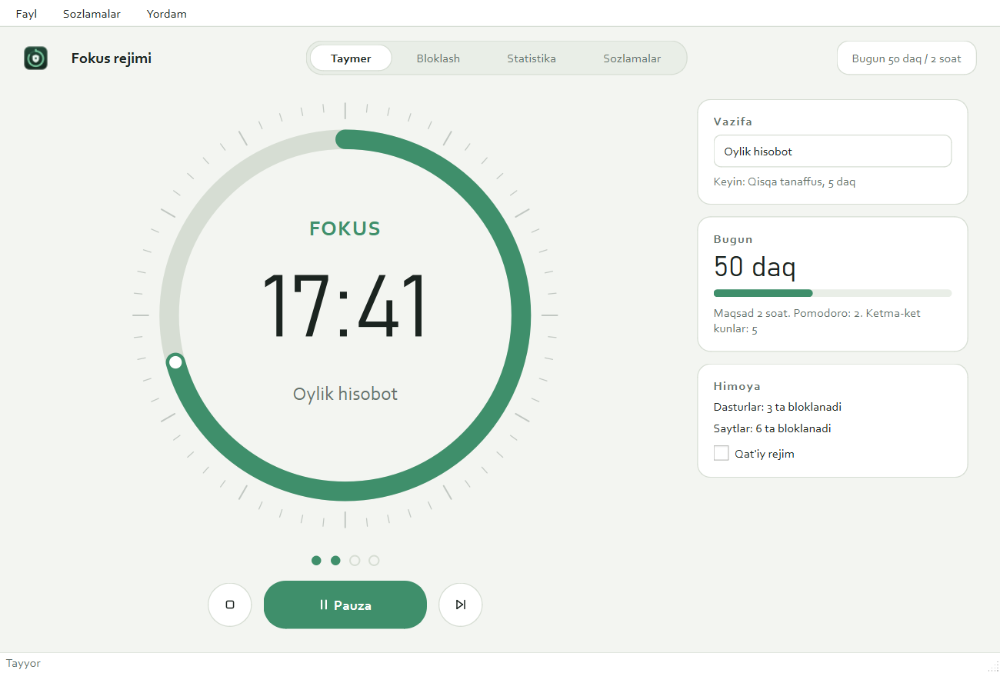
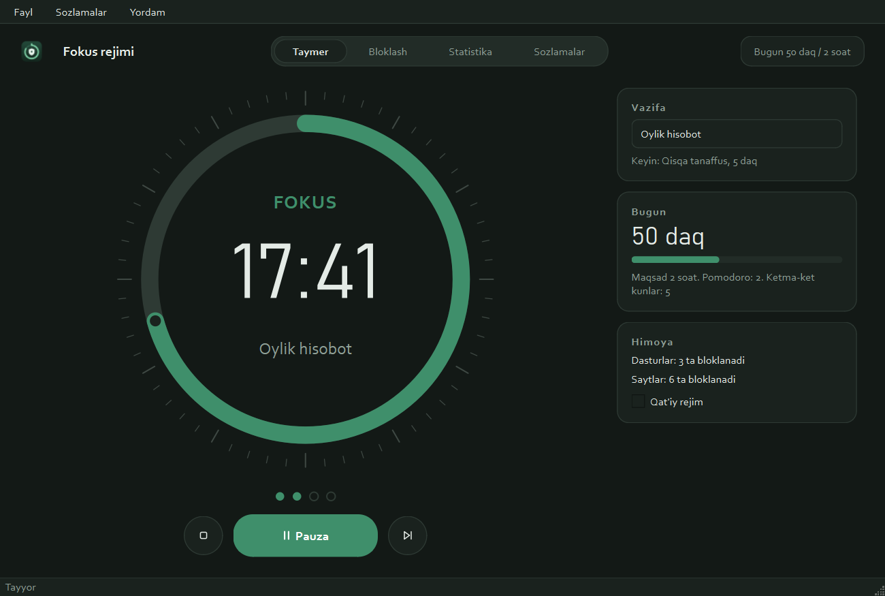
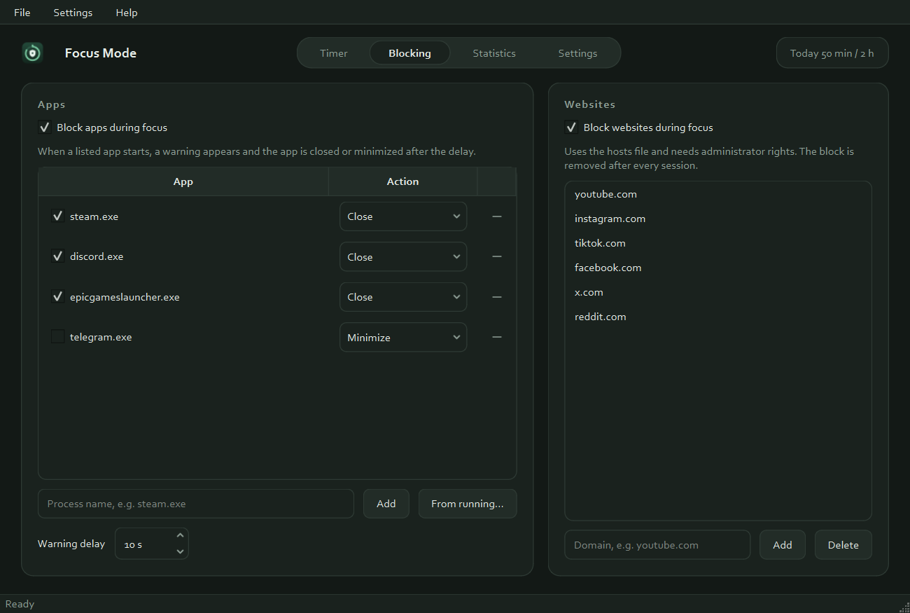
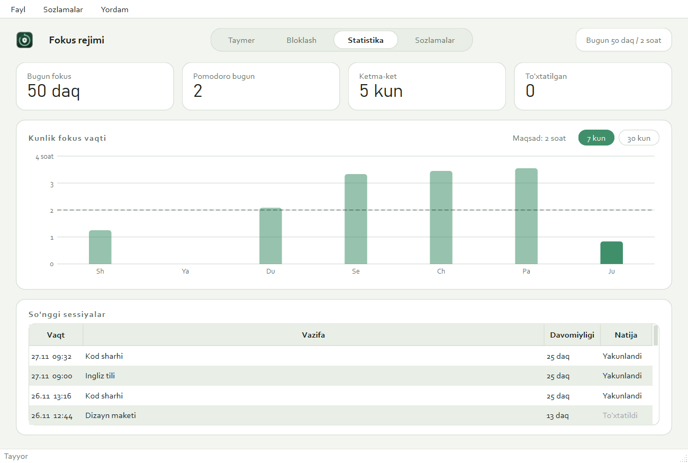
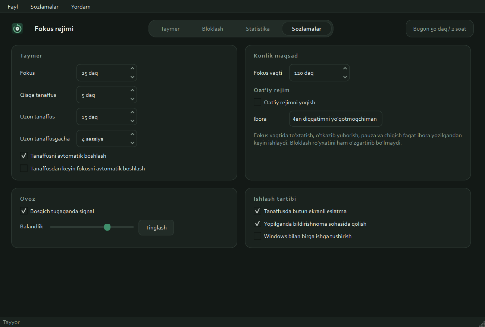

<h1 align="center">Fokus rejimi</h1>

<b>Focus Mode</b> · Режим фокуса

   
  
  
  
  

Pomodoro taymeri: fokus va tanaffuslarni boshqaradi, ish vaqtida chalg'ituvchi dasturlar va saytlarni bloklaydi, kunlik statistika yuritadi.

## Imkoniyatlar

- Fokus, qisqa va uzun tanaffus; davomiyliklarni sozlash mumkin
- Fokus vaqtida tanlangan dasturlarni ogohlantirib yopish yoki yig'ish
- hosts fayli orqali saytlarni bloklash (ixtiyoriy, zaxira nusxa va avtomatik tiklash bilan)
- Qat'iy rejim: sessiyani faqat ibora yozib to'xtatish mumkin
- Kunlik maqsad, ketma-ket kunlar, 7 va 30 kunlik grafik
- Tanaffusda butun ekranli eslatma, yumshoq ovozli signallar
- Bildirishnoma sohasida qolgan vaqt ko'rsatiladi
- O'zbek, rus, ingliz tillari; yorug' va qorong'i mavzu

## Xavfsizlik

- Dasturlar faqat siz tuzgan ro'yxat bo'yicha va faqat fokus vaqtida yopiladi. Tizim jarayonlarini ro'yxatga qo'shib bo'lmaydi.
- Saytlarni bloklash ixtiyoriy. `hosts` fayliga yozishdan oldin zaxira nusxa olinadi, blok maxsus belgilar orasida yoziladi va sessiya tugagach yoki keyingi ishga tushishda olib tashlanadi.
- Windows bilan ishga tushirish standart holatda o'chiq.

## O'rnatish

1. [**FokusRejimi.exe**](https://github.com/eduhakimov/fokus-rejimi/releases/latest/download/FokusRejimi.exe) faylini yuklab oling.
2. Faylni ishga tushiring, o'rnatish shart emas.
3. Windows SmartScreen ogohlantirsa: **Batafsil → Baribir ishga tushirish**.

**Tizim talablari:** Windows 10 (1809+) / Windows 11, x64

---

## Русский

Таймер Помодоро: чередует фокус и перерывы, блокирует отвлекающие программы и сайты во время работы и ведёт статистику по дням.

- Фокус, короткий и длинный перерыв; длительность настраивается
- Закрытие или сворачивание выбранных программ во время фокуса с предупреждением
- Блокировка сайтов через файл hosts (по желанию, с резервной копией и автоматическим восстановлением)
- Строгий режим: прервать сессию можно только вводом фразы
- Цель на день, серия дней, графики за 7 и 30 дней
- Полноэкранное напоминание в перерыв, мягкие звуковые сигналы
- Оставшееся время в области уведомлений
- Узбекский, русский, английский; светлая и тёмная тема

## English

A Pomodoro timer that alternates focus and breaks, blocks distracting apps and websites while you work, and keeps daily statistics.

- Focus, short and long breaks with configurable lengths
- Closes or minimizes chosen apps during focus, after a warning
- Optional website blocking through the hosts file, with backup and automatic cleanup
- Strict mode: a session can only be interrupted by typing a phrase
- Daily goal, day streak, 7 and 30 day charts
- Full-screen break reminder and soft chimes
- Remaining time shown in the notification area
- Uzbek, Russian and English; light and dark themes

---

## Muallif / Author

**Bahtiyorjon Hakimov** (Hakimov Bahtiyorjon Muzaffar o'g'li), [github.com/eduhakimov](https://github.com/eduhakimov)

© 2026 Bahtiyorjon Hakimov. Barcha huquqlar himoyalangan. / Все права защищены. / All rights reserved.
Batafsil: [LICENSE](LICENSE) · Uchinchi tomon komponentlari: [THIRD_PARTY_NOTICES.md](THIRD_PARTY_NOTICES.md)
