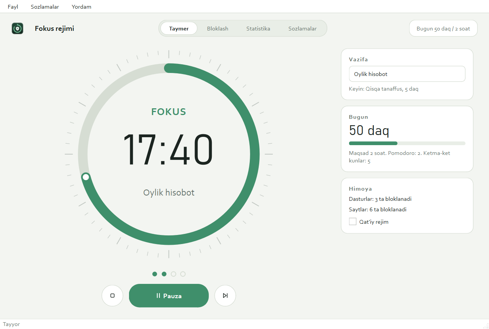
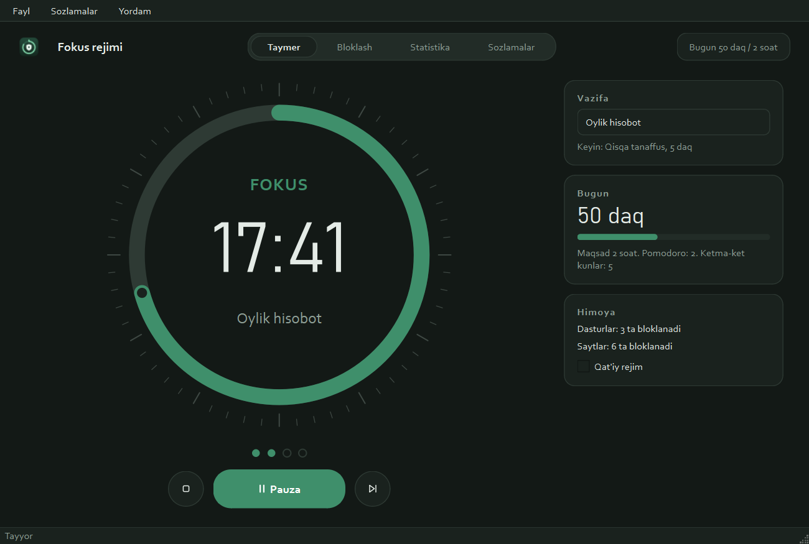
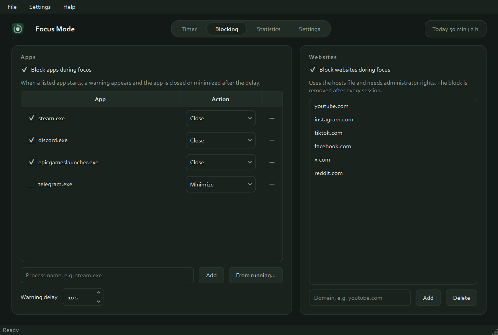
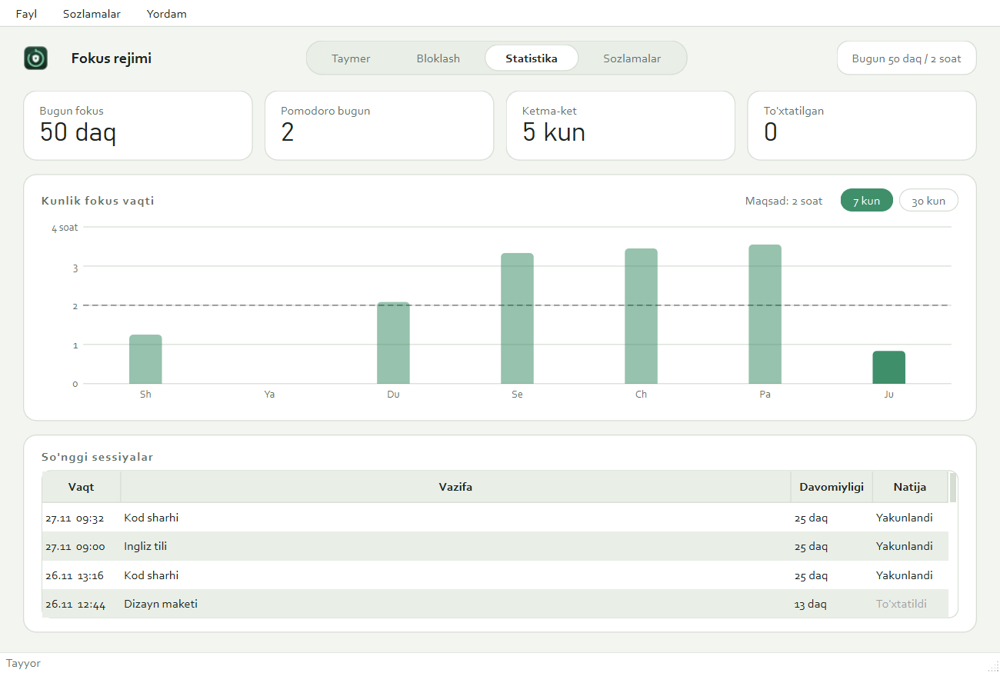
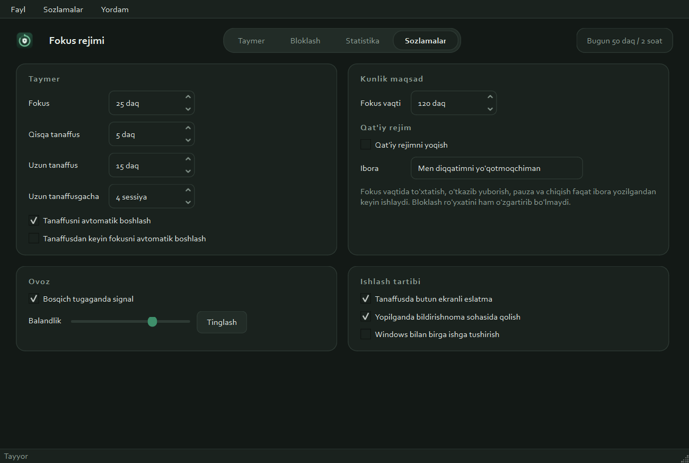

# Fokus rejimi: Foydalanish qo‘llanmasi

Muallif: Hakimov Bahtiyorjon. Versiya: 1.0.2.

## 1. Umumiy ma’lumot

“Fokus rejimi” diqqatni jamlab ishlashga yordam beruvchi Pomodoro taymeri. Ish fokus davrlari (standart 25 daqiqa) va qisqa tanaffuslarga (5 daqiqa) bo‘linadi, har to‘rtinchi fokusdan keyin uzun tanaffus (15 daqiqa) beriladi. Fokus vaqtida dastur siz tanlagan chalg‘ituvchi dasturlarni ogohlantirib yopadi yoki yig‘adi, xohlasangiz saytlarni ham vaqtincha bloklaydi.

Asosiy imkoniyatlar:

- fokus, qisqa va uzun tanaffus; davomiyliklarni sozlash mumkin;
- fokus vaqtida tanlangan dasturlarni ogohlantirib yopish yoki yig‘ish;
- hosts fayli orqali saytlarni bloklash (ixtiyoriy, zaxira nusxa va avtomatik tiklash bilan);
- qat’iy rejim: sessiyani faqat ibora yozib to‘xtatish mumkin;
- kunlik maqsad, ketma-ket kunlar, 7 va 30 kunlik grafik;
- tanaffusda butun ekranli eslatma, yumshoq ovozli signallar;
- bildirishnoma sohasida qolgan vaqtni ko‘rsatish;
- o‘zbek, rus va ingliz tillari, yorug‘ va qorong‘i mavzu.
Dastur talabalar, o‘qituvchilar, dasturchilar, dizaynerlar va kompyuterda uzoq ishlaydigan barcha foydalanuvchilar uchun mo‘ljallangan.

Ushbu qo‘llanmada dasturni yuklab olish va ishga tushirish, oynaning tuzilishi, taymer va bloklash bilan ishlash, sozlamalar, ma’lumotlarni saqlash tartibi va tez-tez uchraydigan savollarga javoblar bayon etilgan. Tugma va bo‘lim nomlari dasturning o‘zbekcha interfeysidagidek berilgan.

## 2. Tizim talablari

- Operatsion tizim: Windows 10 (1809 va undan keyingi versiyalar) yoki Windows 11, 64 bitli.
- Internet aloqasi talab qilinmaydi.
- O‘rnatish shart emas: dastur bitta bajariladigan fayldan iborat.
- Taymer va dasturlarni bloklash uchun administrator huquqi kerak emas. Saytlarni bloklash uchun esa dastur administrator sifatida ishlashi kerak.
- Ovozli signallarni eshitish uchun karnay yoki quloqchin.
Dastur ishlashi uchun qo‘shimcha dasturlar yoki ro‘yxatdan o‘tish talab etilmaydi; ovozli signallar dasturning o‘zi tomonidan yaratiladi.

## 3. O‘rnatish va ishga tushirish

1. Dasturning GitHub sahifasidagi (https://github.com/eduhakimov/fokus-rejimi) Releases bo‘limidan bajariladigan faylni yuklab oling.
2. Faylni doimiy papkaga joylashtiring va ikki marta bosib ishga tushiring.
3. Birinchi ishga tushirishda Windows SmartScreen “Windows kompyuteringizni himoya qildi” ogohlantirishini ko‘rsatishi mumkin. Bu imzolanmagan dasturlar uchun odatiy holat: “Batafsil” havolasini, so‘ng “Baribir ishga tushirish” tugmasini bosing.
4. Saytlarni bloklashni yoqsangiz, dastur administrator sifatida qayta ishga tushishni taklif qiladi. Windows foydalanuvchi hisobini boshqarish (UAC) oynasida ruxsat bering.
5. Windows yoqilganda dastur avtomatik ishga tushishini istasangiz, “Sozlamalar” bo‘limida “Windows bilan birga ishga tushirish” belgisini yoqing. Standart holatda bu o‘chirilgan.
Dasturni yangilash uchun yangi versiyani yuklab olib, eski faylni almashtiring; sozlamalar va statistika saqlanib qoladi. Dasturni o‘chirishdan oldin undan to‘liq chiqing, shunda hosts faylida blok qolmaydi.

## 4. Dastur oynasi bilan tanishish

Oynaning yuqorisida menyu satri (“Fayl”, “Sozlamalar”, “Yordam”), uning ostida dastur nomi, to‘rt bo‘limli almashtirgich (“Taymer”, “Bloklash”, “Statistika”, “Sozlamalar”) va o‘ng burchakda bugungi fokus vaqti hamda kunlik maqsad (masalan, “Bugun 50 daq / 2 soat”) ko‘rsatiladi.

“Taymer” bo‘limida:

- markazdagi aylana taymer: bosqich nomi, qolgan vaqt va vazifa;
- aylana ostidagi nuqtalar: uzun tanaffusgacha bajarilgan fokuslar;
- pastdagi tugmalar: chapdagi – to‘xtatish, o‘rtadagi – “Boshlash” yoki “Pauza”, o‘ngdagi – keyingi bosqichga o‘tish;
- “Vazifa” kartasi: nima ustida ishlayotganingizni yozish maydoni va keyingi bosqich haqida izoh;
- “Bugun” kartasi: bugungi fokus vaqti, maqsad, pomodorolar soni va ketma-ket kunlar;
- “Himoya” kartasi: nechta dastur va sayt bloklanishi hamda “Qat’iy rejim” belgisi.
“Bloklash” bo‘limida chapda “Dasturlar”, o‘ngda “Saytlar” paneli; “Statistika” bo‘limida ko‘rsatkich kartalari, kunlik grafik va so‘nggi sessiyalar jadvali; “Sozlamalar” bo‘limida taymer, kunlik maqsad, qat’iy rejim, ovoz va ishlash tartibi guruhlari joylashgan. Pastdagi holat satrida amallar natijasi haqida xabarlar chiqadi.

*1-rasm. “Taymer” bo‘limi: aylana taymer, “Vazifa”, “Bugun” va “Himoya” kartalari*

*2-rasm. Qorong‘i mavzudagi “Taymer” bo‘limi*

## 5. Asosiy amallar

**Fokus sessiyasini boshlash**

1. “Vazifa” maydoniga nima ustida ishlayotganingizni yozing (ixtiyoriy).
2. “Boshlash” tugmasini bosing yoki aylana taymer ustiga bosing.
3. Fokus tugagach ovozli signal chalinadi va qisqa tanaffus boshlanadi (tanaffusni avtomatik boshlash yoqilgan bo‘lsa). Har to‘rtinchi fokusdan keyin uzun tanaffus beriladi.
4. Vaqtincha to‘xtatish uchun “Pauza”, davom ettirish uchun “Davom ettirish” tugmasini bosing.
5. Chapdagi tugma sessiyani to‘xtatadi, o‘ngdagi tugma keyingi bosqichga o‘tkazadi. O‘tkazib yuborilgan fokus yakunlangan hisoblanmaydi.
**Dasturlarni bloklash**

1. “Bloklash” bo‘limini oching va “Fokus vaqtida dasturlarni bloklash” belgisi yoqilganini tekshiring.
2. Jarayon nomini kiriting (masalan, steam.exe) va qo‘shing yoki “Ishlayotganlardan...” tugmasi bilan hozir ochiq dasturlar ro‘yxatidan tanlang.
3. Har bir dastur uchun amalni tanlang: “Yopish” yoki “Yig‘ish”. Qatorning belgisini olib tashlash qoidani vaqtincha o‘chiradi.
4. “Ogohlantirish vaqti” maydonida dastur yopilgunga qadar necha soniya kutilishini belgilang (3–120 soniya, standart 10).
5. Fokus vaqtida ro‘yxatdagi dastur ochilsa, ekranning yuqorisida “Fokus vaqtida bu dastur bloklangan” xabari va teskari sanoq chiqadi. Muddat tugagach dastur yopiladi yoki yig‘iladi.
Tizim jarayonlarini (explorer.exe, svchost.exe va boshqalar) ro‘yxatga qo‘shib bo‘lmaydi. Ishingizni oldindan saqlang: yopilgan dasturdagi saqlanmagan ma’lumot yo‘qolishi mumkin.

**Saytlarni bloklash**

1. “Bloklash” bo‘limining “Saytlar” qismida “Fokus vaqtida saytlarni bloklash” belgisini yoqing.
2. Dastur administrator sifatida ishlamayotgan bo‘lsa, qayta ishga tushirishni taklif qiladi – rozilik bering.
3. Domen kiriting (masalan, youtube.com) va qo‘shing. To‘liq havola kiritilsa ham dastur uni domenga keltiradi; noto‘g‘ri domen uchun “Domen noto‘g‘ri” xabari chiqadi.
4. Blok faqat fokus vaqtida turadi va tanaffusda, to‘xtatilganda yoki dasturdan chiqilganda olib tashlanadi. Brauzer eski manzilni eslab qolgan bo‘lsa, sahifani yangilang yoki brauzerni qayta oching.
**Qat’iy rejim**

1. “Taymer” bo‘limidagi “Himoya” kartasida yoki “Sozlamalar” bo‘limida qat’iy rejimni yoqing.
2. Fokus vaqtida to‘xtatish, o‘tkazib yuborish, pauza yoki dasturdan chiqish uchun oynada ko‘rsatilgan iborani aynan yozing.
3. Iborani “Sozlamalar” bo‘limidagi “Ibora” maydonida o‘zgartirish mumkin.
**Statistikani ko‘rish**

“Statistika” bo‘limida bugungi fokus vaqti, bugungi pomodorolar, ketma-ket kunlar va to‘xtatilgan sessiyalar soni ko‘rsatiladi. Grafikda “7 kun” yoki “30 kun” tugmasi bilan davrni tanlang; uzuq chiziq kunlik maqsadni bildiradi. “So‘nggi sessiyalar” jadvalida har bir sessiya natijasi ko‘rinadi. Bir daqiqadan qisqa sessiyalar yozilmaydi.

**Tanaffus eslatmasi**

Tanaffus boshlanganda ekran qoraytiriladi va dam olish bo‘yicha tavsiya ko‘rsatiladi. “Tanaffusni o‘tkazish” keyingi fokusga o‘tadi, “Yashirish” yoki Esc faqat eslatmani yopadi, taymer ishlashda davom etadi.

**Bildirishnoma sohasidan boshqarish**

Taymer ishlayotganda oynani yopsangiz, dastur bildirishnoma sohasida (soat yonida) qoladi. Belgi ustiga sichqonchani olib borsangiz, qolgan vaqt ko‘rinadi. Belgini o‘ng tugma bilan bosib, oynani ochish va taymerni boshqarish buyruqlaridan foydalaning. Dasturdan to‘liq chiqish uchun “Fayl” menyusidagi “Chiqish” bandini tanlang.

**Namunaviy ish tartibi**

Ish kunini boshlashda vazifa nomini yozing va fokusni boshlang. Fokus davomida faqat bitta vazifa ustida ishlang, kelgan fikr va xabarlarni tanaffusga qoldiring. Tanaffusda ekrandan uzoqlashing va eslatmadagi tavsiyaga amal qiling. Kun oxirida “Statistika” bo‘limida kunlik maqsadga erishilganini tekshiring.

*3-rasm. “Bloklash” bo‘limi (ingliz tilidagi interfeys): dasturlar jadvali, amallar va saytlar ro‘yxati*

*4-rasm. “Statistika” bo‘limi: kartalar, “Kunlik fokus vaqti” grafigi va “So‘nggi sessiyalar” jadvali*

## 6. Sozlamalar

“Sozlamalar” bo‘limida quyidagi guruhlar mavjud:

- **Taymer:** “Fokus” (1–180 daqiqa), “Qisqa tanaffus” (1–60), “Uzun tanaffus” (1–120), “Uzun tanaffusgacha” (1–12 sessiya), “Tanaffusni avtomatik boshlash”, “Tanaffusdan keyin fokusni avtomatik boshlash”. Yangi davomiyliklar taymer ishlamayotganda darhol, aks holda keyingi bosqichdan qo‘llanadi.
- **Kunlik maqsad:** “Fokus vaqti” (10–960 daqiqa, standart 120).
- **Qat’iy rejim:** “Qat’iy rejimni yoqish” va “Ibora”.
- **Ovoz:** “Bosqich tugaganda signal”, “Balandlik” va “Tinglash” tugmasi.
- **Ishlash tartibi:** “Tanaffusda butun ekranli eslatma”, “Yopilganda bildirishnoma sohasida qolish”, “Windows bilan birga ishga tushirish”.
Qat’iy rejim yoqilgan bo‘lsa, fokus davomida taymer sozlamalari va bloklash ro‘yxatlari qulflanadi.

Interfeys tili (O‘zbekcha, Русский, English) va mavzu (Yorug‘, Qorong‘i, Tizim bo‘yicha) menyu satridagi “Sozlamalar” menyusidan tanlanadi; tilni almashtirish dasturni qayta ishga tushiradi.

Sozlamalar foydalanuvchi profilida saqlanadi va dastur yangilanganda ham saqlanib qoladi. Kunlik maqsad “Taymer” bo‘limidagi “Bugun” kartasida va oynaning yuqori o‘ng burchagidagi belgida ishlatiladi, “Statistika” grafigida esa uzuq chiziq bilan ko‘rsatiladi.

*5-rasm. “Sozlamalar” bo‘limi (qorong‘i mavzu)*

## 7. Ma’lumotlarni saqlash va xavfsizlik

- Sozlamalar va fokus tarixi %APPDATA%\BahtiyorSoft\fokus-rejimi papkasida saqlanadi. Dastur internetga ulanmaydi.
- Dasturlar faqat siz tuzgan ro‘yxat bo‘yicha, faqat fokus vaqtida va faqat sizning Windows hisobingizda ishlayotgan bo‘lsa yopiladi yoki yig‘iladi. Tizim jarayonlari va dasturning o‘zi hech qachon yopilmaydi.
- Saytlarni bloklash ixtiyoriy. hosts fayliga yozishdan oldin uning zaxira nusxasi shu papkadagi “backups” papkasiga saqlanadi (oxirgi 10 ta nusxa qoldiriladi). Blok maxsus belgilar orasida yoziladi va sessiya tugagach olib tashlanadi; hosts faylidagi boshqa qatorlaringiz o‘zgarmaydi.
- Dastur kutilmaganda yopilsa, keyingi ishga tushishda qolgan blok avtomatik tozalanadi va bu haqda xabar beriladi. Huquq yetmasa, dastur administrator sifatida qayta ishga tushishni taklif qiladi.
- Windows bilan birga ishga tushirish standart holatda o‘chirilgan.
- Yopilgan dasturdagi saqlanmagan ma’lumot yo‘qolishi mumkin. Muhim ish bilan band dasturlar uchun “Yig‘ish” amalini tanlang.
- Kompyuterni o‘chirishdan oldin dasturdan to‘liq chiqish tavsiya etiladi; shunday qilinmasa ham, blok keyingi ishga tushishda olib tashlanadi.

## 8. Ko‘p uchraydigan savollar va muammolar

**Sayt ochilyapti, bloklanmagan.** Dastur administrator sifatida ishlayotganini va “Himoya” kartasida saytlar soni ko‘rsatilganini tekshiring. Brauzer manzilni eslab qolgan bo‘lishi mumkin: sahifani yangilang yoki brauzerni qayta oching.

**“Saytlar: administrator huquqi kerak” yozuvi chiqdi.** Saytlarni bloklash uchun dasturni administrator sifatida ishga tushiring; dastur buni o‘zi taklif qiladi.

**Dasturni ro‘yxatga qo‘sha olmayapman.** U tizim jarayoni bo‘lishi mumkin; bunday holda “Tizim jarayoni, bloklab bo‘lmaydi” xabari chiqadi.

**Bloklangan dastur yopilmadi.** U boshqa foydalanuvchi nomidan yoki administrator huquqi bilan ishlayotgan bo‘lishi mumkin; dastur faqat sizning hisobingizdagi jarayonlarga tegadi.

**Qat’iy rejimda sessiyani to‘xtata olmayapman.** Oynada ko‘rsatilgan iborani to‘liq yozing. Katta-kichik harflar va ortiqcha bo‘shliqlar ahamiyatga ega emas, ammo barcha so‘zlar to‘g‘ri yozilishi kerak.

**Oynani yopdim, taymer ishlayaptimi?** Ha, “Yopilganda bildirishnoma sohasida qolish” yoqilgan bo‘lsa, dastur bildirishnoma sohasida ishlaydi; belgi ustiga sichqoncha olib borsangiz qolgan vaqt ko‘rinadi.

**Qisqa sessiya statistikada ko‘rinmayapti.** Bir daqiqadan qisqa fokus sessiyalari yozilmaydi.

**SmartScreen dasturni ishga tushirishga ruxsat bermayapti.** “Batafsil” havolasini, so‘ng “Baribir ishga tushirish” tugmasini bosing. Faylni faqat rasmiy GitHub sahifasidan yuklab oling.

**hosts faylining zaxira nusxasi qayerda?** %APPDATA%\BahtiyorSoft\fokus-rejimi papkasidagi “backups” papkasida, sana va vaqt qo‘shilgan nom bilan saqlanadi.

**Ovozli signal eshitilmayapti.** “Sozlamalar” bo‘limida “Bosqich tugaganda signal” yoqilganini, “Balandlik” nolga tushirilmaganini tekshiring va “Tinglash” tugmasi bilan sinab ko‘ring.

**Dastur kutilmagan xato haqida xabar berdi.** Xato tafsilotlari ma’lumotlar papkasidagi jurnal fayliga yoziladi. Muammo takrorlansa, shu faylni GitHub sahifasi orqali muallifga yuboring.

