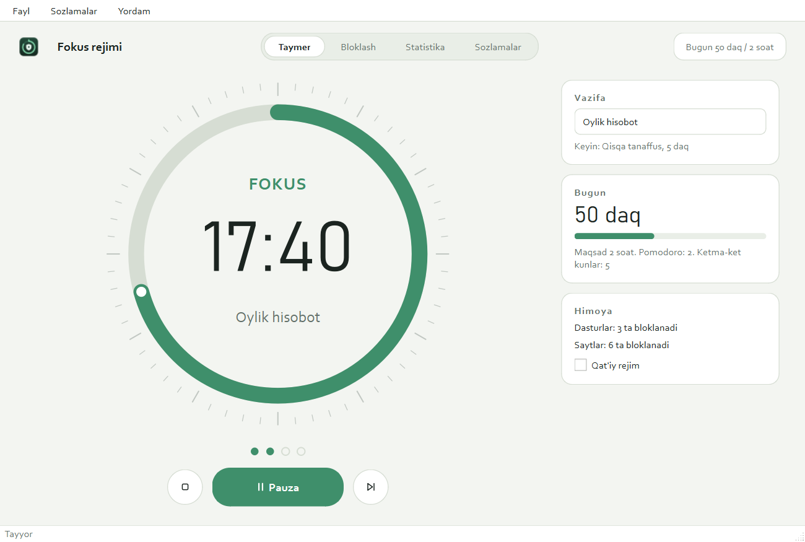
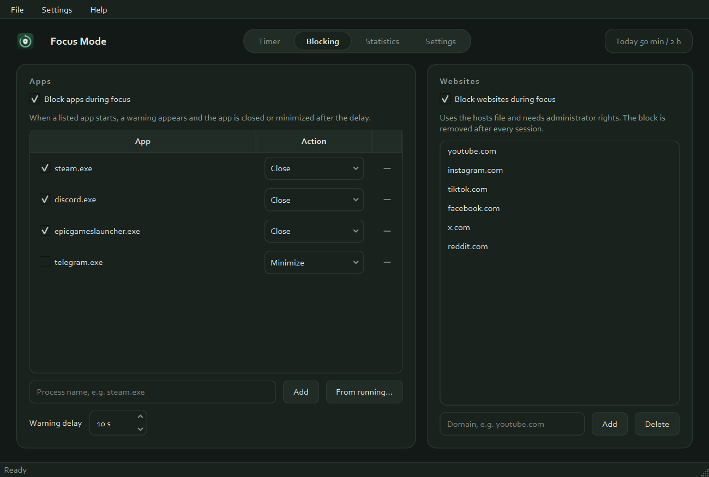
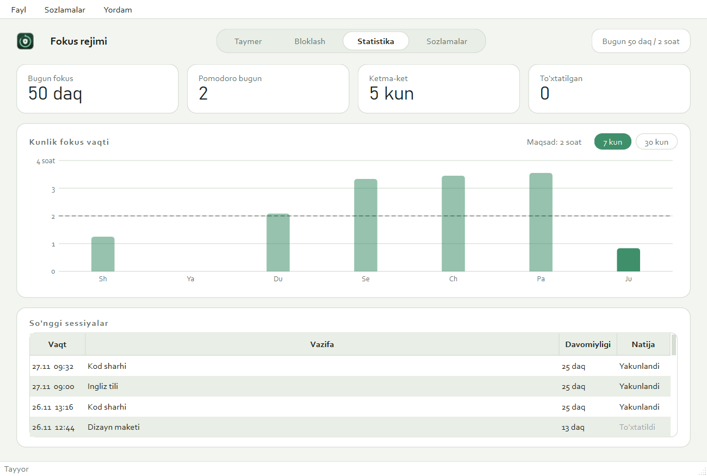
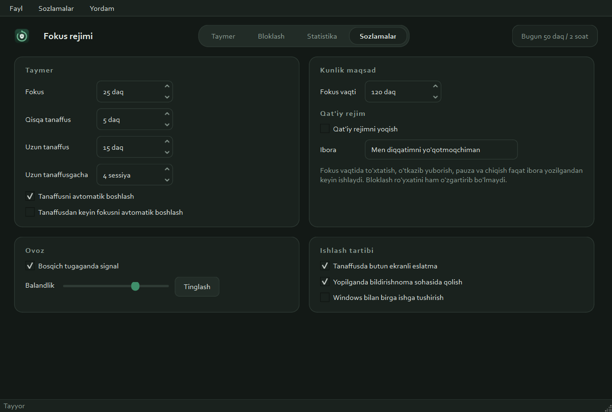

UDK: 004.42:159.952

# Pomodoro usuliga asoslangan, chalg‘ituvchi dasturlar va saytlarni boshqariladigan tarzda bloklovchi diqqatni jamlash dasturi: holatlar mashinasi, xavfsizlik choralari va amalga oshirish

**Hakimov Bahtiyorjon**  
*[ish joyi, lavozimi, elektron pochta]*

**Annotatsiya.** Maqolada fokus va tanaffus davrlarini almashtiruvchi, fokus vaqtida chalg‘ituvchi dasturlar va saytlarni bloklovchi “Fokus rejimi” dasturi tavsiflanadi. Taymer holatlar mashinasi sifatida modellashtirilgan: fokus, qisqa va uzun tanaffus davomiyliklari sozlanadi, har to‘rtinchi fokusdan keyin uzun tanaffus beriladi. Dasturlarni bloklash ogohlantirish va kechikish bilan faqat foydalanuvchi ro‘yxati bo‘yicha, joriy foydalanuvchi jarayonlariga nisbatan bajariladi, tizim jarayonlari himoyalangan. Saytlarni bloklash ixtiyoriy bo‘lib, Windows hosts fayliga zaxira nusxa olingan holda belgilangan blok yozish orqali amalga oshiriladi va sessiya tugagach olib tashlanadi. Statistika SQLite bazasida yuritiladi. Dastur Python 3.12 va PySide6 asosida yaratilgan va internetsiz ishlaydi.

*Kalit so‘zlar:* Pomodoro usuli, diqqatni jamlash, dasturlarni bloklash, hosts fayli, holatlar mashinasi, PySide6, oflayn dastur.

**Программа концентрации внимания на основе метода Помодоро с контролируемой блокировкой отвлекающих программ и сайтов: конечный автомат, меры безопасности и реализация**

**Аннотация.** В статье описывается программа «Fokus rejimi», чередующая периоды фокуса и перерывов и блокирующая во время фокуса отвлекающие программы и сайты. Таймер смоделирован как конечный автомат: длительности фокуса, короткого и длинного перерыва настраиваются, после каждого четвёртого фокуса даётся длинный перерыв. Блокировка программ выполняется с предупреждением и задержкой только по списку пользователя и только для процессов текущего пользователя, системные процессы защищены. Блокировка сайтов необязательна и выполняется записью помеченного блока в файл hosts Windows с предварительной резервной копией; блок удаляется после сеанса. Статистика ведётся в базе SQLite. Программа создана на Python 3.12 и PySide6 и работает без интернета.

*Ключевые слова:* метод Помодоро, концентрация внимания, блокировка программ, файл hosts, конечный автомат, PySide6, офлайн-программа.

**A Pomodoro-Based Focus Application with Controlled Blocking of Distracting Programs and Websites: State Machine, Safety Measures and Implementation**

**Abstract.** The paper describes “Fokus rejimi”, a program that alternates focus and break periods and blocks distracting programs and websites during focus. The timer is modelled as a state machine: focus, short break and long break lengths are configurable, and a long break follows every fourth focus period. Program blocking acts after a warning and delay, only on the user’s list and only on the current user’s processes, while system processes are protected. Website blocking is optional and works by writing a marked block into the Windows hosts file after making a backup; the block is removed when the session ends. Statistics are kept in an SQLite database. The program is built with Python 3.12 and PySide6 and works offline.

*Keywords:* Pomodoro technique, focus, application blocking, hosts file, state machine, PySide6, offline software.

## Kirish

Kompyuterda ishlash va o‘qish jarayonida diqqatni uzoq vaqt bir vazifada ushlab turish tobora qiyinlashmoqda: ijtimoiy tarmoqlar, video xizmatlari, messenjerlar va o‘yin platformalari doimiy ravishda e’tiborni chalg‘itadi. Mutaxassis yoki talaba bir vazifadan ikkinchisiga tez-tez o‘tganda ishning samarasi pasayadi, chuqur o‘ylashni talab qiladigan topshiriqlar cho‘ziladi.

Amaliyotda diqqatni boshqarishning keng tarqalgan usullaridan biri ishni belgilangan davomiylikdagi fokus davrlari va ular orasidagi qisqa tanaffuslarga bo‘lishdir; bunday yondashuv “Pomodoro” usuli nomi bilan tanilgan. Klassik sxemada 25 daqiqalik fokusdan keyin qisqa tanaffus, bir necha fokusdan keyin esa uzunroq tanaffus beriladi. Biroq taymerning o‘zi chalg‘ituvchi omillarni yo‘qotmaydi: fokus vaqtida ham foydalanuvchi o‘yin yoki ijtimoiy tarmoqni ochishi mumkin. Shu sababli taymerni chalg‘ituvchi dasturlar va saytlarni vaqtincha cheklash bilan birlashtirish maqsadga muvofiq.

“Raqamli O‘zbekiston – 2030” strategiyasida raqamli ta’lim va raqamli ko‘nikmalarni rivojlantirish vazifalari belgilangan. Raqamli muhitda o‘z diqqatini boshqara olish ushbu ko‘nikmalarning muhim tarkibiy qismi bo‘lib, uni qo‘llab-quvvatlovchi vositalar talabalar va mutaxassislar uchun amaliy ahamiyatga ega.

Mazkur maqolada Pomodoro taymerini dasturlar va saytlarni boshqariladigan tarzda bloklash bilan birlashtirgan “Fokus rejimi” dasturi taqdim etiladi. Tadqiqot obyekti sifatida kompyuterda diqqatni jamlab ishlash jarayoni, predmeti sifatida esa taymer holatlar mashinasi, bloklash algoritmlari, ularning xavfsizlik choralari va dasturiy arxitektura olingan. Bloklash operatsion tizim bilan bevosita o‘zaro ta’sirni talab qilgani uchun maqolada xavfsizlik masalalariga alohida e’tibor qaratiladi.

Maqolaning tuzilishi quyidagicha: dastlab masala qo‘yilib, mavjud yechim turlari tahlil qilinadi; so‘ngra taymer holatlar mashinasi, dasturlar va saytlarni bloklash algoritmlari hamda ularning xavfsizlik choralari bayon etiladi; keyin amalga oshirilgan funksiyalar va avtomatik testlar ko‘rib chiqiladi; yakunda yechimning afzalliklari va cheklovlari muhokama qilinadi.

## Muammoning qo‘yilishi va mavjud yechimlar tahlili

Masalani quyidagicha ifodalash mumkin. Dastur fokus, qisqa tanaffus va uzun tanaffus bosqichlarini sozlanadigan davomiylik bilan almashtirishi, pauza, to‘xtatish va keyingi bosqichga o‘tishni qo‘llab-quvvatlashi kerak. Fokus vaqtida foydalanuvchi belgilagan dasturlar ochilsa, ular ogohlantirishdan so‘ng yopilishi yoki yig‘ilishi, belgilangan saytlar esa ochilmasligi lozim. Bunda bloklash hech qachon tizim jarayonlariga, boshqa foydalanuvchilar jarayonlariga yoki foydalanuvchi ro‘yxatida bo‘lmagan dasturlarga ta’sir qilmasligi, saytlarni bloklash uchun o‘zgartirilgan tizim fayli esa har qanday holatda, shu jumladan dastur kutilmaganda yopilganda ham, asl holatiga qaytarilishi shart. Bundan tashqari, dastur fokus statistikasini yuritishi va foydalanuvchining kunlik maqsadga erishishini ko‘rsatishi kerak.

Amaliyotda ushbu vazifalar quyidagi yechim turlari bilan hal qilinadi:

- Oddiy taymer ilovalari va veb-sahifalar. Ular vaqtni o‘lchaydi, lekin chalg‘ituvchi dasturlar va saytlarga ta’sir qilmaydi.
- Brauzer kengaytmalari. Ular saytlarni faqat o‘sha brauzerda bloklaydi va kompyuterdagi boshqa dasturlarni qamramaydi.
- Ota-ona nazorati va tashkiliy cheklash tizimlari. Ular keng nazorat imkoniyatiga ega, ammo uzoq muddatli cheklash uchun mo‘ljallangan, sozlash murakkab va ko‘pincha foydalanuvchining o‘zi emas, boshqa shaxs tomonidan boshqariladi.
- Mobil qurilmalardagi diqqat rejimlari. Ular kompyuterdagi ish jarayoniga taalluqli emas.
Tahlil asosida ishlab chiqilayotgan vositaga quyidagi talablar qo‘yildi: sozlanadigan Pomodoro taymeri; fokus vaqtida va faqat foydalanuvchi ro‘yxati bo‘yicha dasturlarni ogohlantirish bilan yopish yoki yig‘ish; tizim jarayonlarini himoya qilish; saytlarni bloklashning ixtiyoriyligi, zaxira nusxa va avtomatik tiklash; o‘zini o‘zi cheklashni kuchaytiruvchi qat’iy rejim; statistika va kunlik maqsad; internetsiz ishlash; o‘zbek tilidagi interfeys.

## Tadqiqot metodologiyasi va dasturiy arxitektura

Dastur Python 3.12 tilida yozilgan. Grafik interfeys PySide6 (Qt 6) yordamida qurilgan, ovozli signallarni ijro etish uchun Qt Multimedia moduli, belgilarni chizish uchun Qt SVG moduli ishlatiladi. Jarayonlar ro‘yxatini olish va ularni yopish uchun psutil kutubxonasi, oynalarni yig‘ish uchun pywin32 orqali Windows API funksiyalari qo‘llanadi. Ovozli signallar dastur tomonidan NumPy yordamida sintez qilinadi va WAV fayl sifatida yaratiladi; ijro mumkin bo‘lmasa, standart Windows ovoz moduli zaxira sifatida ishlatiladi. Fokus tarixi SQLite bazasida, sozlamalar JSON faylda saqlanadi. Dastur PyInstaller yordamida bitta bajariladigan faylga yig‘iladi.

Manba kodi vazifalar bo‘yicha modullarga ajratilgan: taymer (holatlar mashinasi), dasturlarni bloklash, hosts fayli bilan ishlash, statistika, ovozlar, sozlamalar, tizim yordamchilari (avtomatik ishga tushirish, xavfsiz rejim), sahifalar, ekran ustidagi oynalar (ogohlantirish va tanaffus eslatmasi), interfeys elementlari va asosiy oyna. Taymer, bloklovchi va hosts moduli interfeysdan mustaqil.

Ma’lumotlar oqimi quyidagicha tashkil etilgan. Interfeysdagi taymer har soniyada taymer holatlar mashinasini yangilaydi; mashina bosqich tugashi, yangi bosqich boshlanishi kabi hodisalar ro‘yxatini qaytaradi. Asosiy oyna bu hodisalarga javoban ovozli signal chaladi, tanaffus eslatmasini ko‘rsatadi, sessiyani statistika bazasiga yozadi hamda bloklashni yoqadi yoki o‘chiradi. Fokus boshlanganda dasturlar bloklovchisi ishga tushiriladi va saytlar bloki qo‘llanadi, fokus tugaganda esa ikkalasi bekor qilinadi. Shu tariqa bloklash holati har doim taymer holatidan kelib chiqadi va mustaqil ravishda “yoqilgan holda qolib ketishi” mumkin emas.

Taymer holatlar mashinasi. Taymer uch bosqichga ega: fokus, qisqa tanaffus va uzun tanaffus. Bosqichlarning standart davomiyligi mos ravishda 25, 5 va 15 daqiqa, uzun tanaffus har 4 fokusdan keyin beriladi; foydalanuvchi bu qiymatlarni o‘zgartirishi mumkin (fokus 1–180, qisqa tanaffus 1–60, uzun tanaffus 1–120 daqiqa, uzun tanaffusgacha 1–12 sessiya). Taymer joriy vaqtni tashqi soat funksiyasidan oladi, shuning uchun uning mantig‘i testlarda real vaqtni kutmasdan tekshiriladi. Boshlash, pauza, davom ettirish, to‘xtatish va o‘tkazib yuborish amallari aniq belgilangan o‘tishlarga ega: pauza qolgan vaqtni saqlaydi; to‘xtatish joriy bosqichni bekor qilib, taymerni boshlang‘ich fokus holatiga qaytaradi va o‘tgan vaqtni xabar qiladi; o‘tkazib yuborish bosqichni muddatidan oldin yakunlaydi, ammo uni bajarilgan deb hisoblamaydi. Sozlamalardagi yangi davomiyliklar taymer bo‘sh turganda darhol, aks holda keyingi bosqichdan qo‘llanadi. Tanaffus va keyingi fokusni avtomatik boshlash alohida sozlanadi.

Dasturlarni bloklash algoritmi. Bloklash qaror qabul qiluvchi qism va ijrochi qismga ajratilgan; jarayonlar ro‘yxatini beruvchi funksiya va ijrochi tashqaridan beriladi, bu esa mantiqni real jarayonlarga tegmasdan testlash imkonini beradi. Fokus vaqtida bloklovchi jarayonlar ro‘yxatini muntazam ko‘rib chiqadi. Ro‘yxatdagi yoqilgan qoidaga mos jarayon topilsa, ekranning yuqorisida ogohlantirish oynasi chiqadi va teskari sanoq boshlanadi (standart 10 soniya, sozlanadi 3–120 soniya). Muddat tugaganda jarayon hali ishlayotgan bo‘lsa, ijrochi uni qoidaga ko‘ra yopadi yoki oynalarini yig‘adi. Yopishda avval jarayonga yakunlash signali yuboriladi, belgilangan vaqtda yopilmasa, u majburan to‘xtatiladi; bu amallar interfeys qotib qolmasligi uchun fon oqimida bajariladi. Agar foydalanuvchi ogohlantirish davomida dasturni o‘zi yopsa, ogohlantirish bekor qilinadi. Yig‘ish qoidasidagi dastur qayta ochilsa, u yangi ogohlantirishsiz yana yig‘iladi.

Dasturlarni bloklash xavfsizlik choralari. Bloklovchi faqat uchta shart bir vaqtda bajarilganda jarayonga ta’sir qiladi: jarayon nomi foydalanuvchi ro‘yxatida va qoida yoqilgan; jarayon joriy foydalanuvchi hisobida ishlamoqda; jarayon nomi qat’iy belgilangan taqiqlangan ro‘yxatda emas. Taqiqlangan ro‘yxatga Windows qobig‘i, tizim xizmatlari, xavfsizlik vositalari, buyruq qatori qobiqlari, Python interpretatori va dasturning o‘zi kiradi; bunday nomni bloklash ro‘yxatiga qo‘shishga urinilganda “Tizim jarayoni, bloklab bo‘lmaydi” xabari chiqadi. Dasturning o‘z jarayoni va egasi aniqlanmagan jarayonlar ham hisobga olinmaydi. Dastur testlar, skrinshot va o‘z-o‘zini tekshirish rejimlarida real jarayonlarga tegmaydigan, faqat amallarni qayd etuvchi ijrochidan foydalanadi.

Saytlarni bloklash algoritmi. Saytlarni bloklash standart holatda o‘chirilgan va administrator huquqini talab qiladi; dastur bunday huquqsiz ishlayotgan bo‘lsa, uni administrator sifatida qayta ishga tushirishni taklif qiladi. Foydalanuvchi kiritgan manzil domen ko‘rinishiga keltiriladi (protokol, yo‘l va “www.” qismi olib tashlanadi) va to‘g‘riligi tekshiriladi. Fokus boshlanganda Windows hosts faylining zaxira nusxasi ilova ma’lumotlari papkasidagi alohida papkaga vaqt belgisi bilan saqlanadi (oxirgi 10 ta nusxa qoldiriladi), so‘ng faylga boshlanish va tugash belgilari orasida har bir domen va uning “www.” varianti uchun 0.0.0.0 manziliga yo‘naltiruvchi qatorlar yoziladi va DNS keshi tozalanadi. Tanaffus boshlanganda, taymer to‘xtatilganda yoki dasturdan chiqilganda faqat belgilar orasidagi blok olib tashlanadi; fayldagi foydalanuvchining boshqa qatorlari, qator oxiri belgilari va kodlash o‘zgarmaydi. Dastur kutilmaganda yopilgan bo‘lsa, keyingi ishga tushishda qolgan blok aniqlanadi va olib tashlanadi; buning uchun huquq yetmasa, foydalanuvchiga administrator sifatida qayta ishga tushirish taklif etiladi.

Qat’iy rejim. Yoqilganda fokus vaqtida pauza, to‘xtatish, o‘tkazib yuborish va dasturdan chiqish amallari faqat foydalanuvchi oldindan belgilangan iborani yozgandan keyin bajariladi (standart ibora: “Men diqqatimni yo‘qotmoqchiman”); solishtirishda katta-kichik harflar va ortiqcha bo‘shliqlar hisobga olinmaydi, ammo iboraning barcha so‘zlari to‘liq yozilishi kerak. Bloklash ro‘yxatlari va taymer sozlamalari ham fokus davomida qulflanadi. Bu mexanizm o‘zini o‘zi cheklashni kuchaytiradi, lekin foydalanuvchini dasturdan butunlay mahrum qilmaydi.

Ma’lumotlar va oflayn ishlash. Fokus sessiyalari boshlanish va tugash vaqti, bosqich, rejalashtirilgan va haqiqiy davomiylik, vazifa nomi va yakunlanganlik belgisi bilan SQLite bazasiga yoziladi; bir daqiqadan qisqa fokus sessiyalari yozilmaydi. Barcha ma’lumotlar foydalanuvchi profilidagi ilova ma’lumotlari papkasida (%APPDATA%\BahtiyorSoft\fokus-rejimi) saqlanadi. Dastur kodida internetga murojaat yo‘q. Windows bilan birga ishga tushirish standart holatda o‘chirilgan va faqat foydalanuvchi belgilaganda yoqiladi.

## Amalga oshirish va asosiy funksiyalar

Asosiy oynaning yuqori qismida dastur nomi, to‘rt bo‘limli almashtirgich (“Taymer”, “Bloklash”, “Statistika”, “Sozlamalar”) va bugungi fokus vaqtini kunlik maqsad bilan ko‘rsatuvchi belgi joylashgan.

“Taymer” bo‘limi. Markazda aylana ko‘rinishidagi taymer joylashgan: unda bosqich nomi (“FOKUS”, “QISQA TANAFFUS” yoki “UZUN TANAFFUS”), qolgan vaqt va vazifa nomi ko‘rsatiladi, aylana bo‘ylab bosqichning o‘tgan qismi chiziladi. Aylana ostidagi nuqtalar uzun tanaffusgacha bajarilgan fokuslarni bildiradi. Pastda uchta tugma bor: to‘xtatish, boshlash yoki pauza va keyingi bosqichga o‘tish. O‘ng tomonda “Vazifa” maydoni (keyingi bosqich haqida izoh bilan), “Bugun” kartasi (fokus vaqti, kunlik maqsad, pomodorolar soni va ketma-ket kunlar) va “Himoya” kartasi (nechta dastur va sayt bloklanishi hamda “Qat’iy rejim” belgisi) joylashgan.

“Bloklash” bo‘limi. Chap qismdagi “Dasturlar” panelida “Fokus vaqtida dasturlarni bloklash” belgisi, dasturlar jadvali (yoqilganlik belgisi, dastur nomi, “Yopish” yoki “Yig‘ish” amali, o‘chirish tugmasi), jarayon nomini kiritish maydoni, qo‘shish va “Ishlayotganlardan...” tugmalari hamda “Ogohlantirish vaqti” maydoni joylashgan. “Ishlayotganlardan...” tugmasi joriy foydalanuvchining hozir ishlayotgan dasturlari ro‘yxatini ko‘rsatadi va ulardan tanlash imkonini beradi. Standart ro‘yxatda o‘yin platformalari va messenjerlar bor. O‘ng qismdagi “Saytlar” panelida “Fokus vaqtida saytlarni bloklash” belgisi, domenlar ro‘yxati va domen qo‘shish hamda o‘chirish vositalari bor; standart ro‘yxatda oltita ommabop video va ijtimoiy tarmoq domeni berilgan.

“Statistika” bo‘limi. Yuqorida to‘rtta karta joylashgan: “Bugun fokus”, “Pomodoro bugun”, “Ketma-ket” (kamida bitta yakunlangan fokusga ega ketma-ket kunlar) va “To‘xtatilgan”. “Kunlik fokus vaqti” grafigi 7 yoki 30 kunlik davrni ko‘rsatadi, uzuq chiziq kunlik maqsadni bildiradi. “So‘nggi sessiyalar” jadvalida vaqt, vazifa, davomiylik va natija (“Yakunlandi” yoki “To‘xtatildi”) beriladi.

“Sozlamalar” bo‘limi. “Taymer” guruhida fokus, qisqa tanaffus, uzun tanaffus davomiyligi, uzun tanaffusgacha sessiyalar soni va avtomatik boshlash belgilari; “Kunlik maqsad” guruhida fokus vaqti maqsadi (10–960 daqiqa); “Qat’iy rejim” guruhida rejimni yoqish va iborani o‘zgartirish; “Ovoz” guruhida bosqich tugaganda signal, ovoz balandligi va “Tinglash” tugmasi; “Ishlash tartibi” guruhida tanaffusda butun ekranli eslatma, yopilganda bildirishnoma sohasida qolish va Windows bilan birga ishga tushirish belgilari joylashgan.

Ekran ustidagi oynalar. Bloklangan dastur ochilganda ekranning yuqorisida “Fokus vaqtida bu dastur bloklangan” xabari va qolgan soniyalar ko‘rsatiladi. Tanaffus boshlanganda butun ekranli eslatma chiqadi: unda ekrandan uzoqlashish, yelka va bo‘yinni yozish, suv ichish yoki chuqur nafas olish kabi tavsiyalardan biri beriladi; “Tanaffusni o‘tkazish” tugmasi keyingi fokusga o‘tadi, “Yashirish” tugmasi yoki Esc tugmasi esa faqat eslatmani yopadi.

Bildirishnoma sohasi. Taymer ishlayotganda oyna yopilsa, dastur bildirishnoma sohasida qoladi; belgi ustiga sichqoncha olib borilganda qolgan vaqt ko‘rinadi, kontekst menyusida boshqaruv buyruqlari mavjud.

Interfeys tili (O‘zbekcha, Русский, English) va mavzu (Yorug‘, Qorong‘i, Tizim bo‘yicha) menyu satridagi “Sozlamalar” menyusi orqali tanlanadi.

*1-rasm. “Taymer” bo‘limi (yorug‘ mavzu): aylana taymer, fokus bosqichi va qolgan vaqt, o‘ngda “Vazifa”, “Bugun” va “Himoya” kartalari*

*2-rasm. “Bloklash” bo‘limi ingliz tilidagi interfeysda: chapda dasturlar ro‘yxati va amallari, o‘ngda bloklanadigan saytlar ro‘yxati*

*3-rasm. “Statistika” bo‘limi: bugungi ko‘rsatkichlar, kunlik fokus vaqti grafigi (uzuq chiziq – kunlik maqsad) va so‘nggi sessiyalar jadvali*

*4-rasm. Qorong‘i mavzudagi “Sozlamalar” bo‘limi: taymer, kunlik maqsad, qat’iy rejim, ovoz va ishlash tartibi guruhlari*

## Sinov va natijalar

Dastur pytest asosidagi avtomatik testlar bilan tekshiriladi. Testlar yetti faylda joylashgan 39 ta test funksiyasidan iborat.

- Taymer testlari (8 ta). Ular fokusni boshlash va yakunlashni, to‘rtta fokusdan keyin uzun tanaffus berilishini, pauza va davom ettirishda qolgan vaqt saqlanishini, to‘xtatishda o‘tgan vaqt xabar qilinib holat tiklanishini, bo‘sh taymerda o‘tkazib yuborish hech narsani boshlamasligini, ishlayotgan fokusni o‘tkazib yuborish bajarilgan hisoblanmasligini, yangi sozlamalar faqat bo‘sh holatda qo‘llanishini va vaqt formatlashni tekshiradi.
- Dasturlarni bloklash testlari (8 ta). Ular nomlarni normallashtirishni, ogohlantirish va muddatdan keyin yopishni, foydalanuvchi dasturni o‘zi yopganda ogohlantirish bekor qilinishini, taqiqlangan ro‘yxat va o‘chirilgan qoidalar e’tiborsiz qolishini, dasturning o‘z jarayoni va egasi noma’lum jarayonlar o‘tkazib yuborilishini, yig‘ish qoidasidagi dastur qayta yig‘ilishini, tanlash ro‘yxati filtrlanishini va real ijrochi testning o‘zi yaratgan sinov jarayonini yopishini tekshiradi.
- hosts fayli testlari (7 ta). Ular domenni normallashtirishni, blok qo‘shilib olib tashlanganda fayl aynan tiklanishini, blokni qayta yozishni, tugallanmagan blokni olib tashlashni, blokdan keyingi foydalanuvchi qatorlari saqlanishini, bo‘sh ro‘yxat faylni o‘zgartirmasligini va xavfsiz rejimda faylga tegilmasligini tekshiradi.
- Ssenariy testlari (5 ta). Ular blok qo‘shilib olib tashlangach fayl baytma-bayt asl holiga qaytishini, real hosts faylining nusxasida to‘liq siklni, faqat o‘qish uchun ochilgan fayl bilan xatosiz ishlashni, fokus sessiyasida saytlar bloklanishi va sinov dasturi yopilishini hamda menyudagi chiqish amali dasturni haqiqatan yopishini tekshiradi.
- Boshqa testlar (11 ta). Ular ovoz signalining shaklini, avtomatik ishga tushirishning soxta reyestr bilan ishlashini, testlarda xavfsiz rejim yoqilishini, sozlamalar turlarini tekshirishni, qat’iy rejim iborasini solishtirishni, statistika va ketma-ket kunlarni, namoyish ma’lumotlarini, oynaning yaratilishini, matnlarning uch tilda to‘liqligini, oyna amallarining xavfsizligini va qat’iy rejimda ibora talab qilinishini tekshiradi.
Testlar real hosts fayliga va foydalanuvchi jarayonlariga tegmaydi: hosts testlari faylning vaqtinchalik nusxasida, bloklash testlari soxta jarayonlar ro‘yxati va test o‘zi yaratgan sinov jarayoni bilan bajariladi. Hosts faylining baytma-bayt tiklanishini tekshiruvchi test saytlarni bloklashning eng muhim xavfsizlik talabini bevosita tasdiqlaydi.

Dastur Windows 10 (1809 va undan keyingi versiyalar) hamda Windows 11 operatsion tizimlarining 64 bitli versiyalari uchun mo‘ljallangan. Interfeys o‘zbek, rus va ingliz tillarida mavjud. Foydalanuvchilar diqqati yoki unumdorligiga ta’siri bo‘yicha tajribalar o‘tkazilmagan, shu sababli maqolada bunday ko‘rsatkichlar keltirilmaydi.

## Muhokama

Taklif etilgan yechimning afzalliklari quyidagilardan iborat. Birinchidan, taymer va bloklash bitta dasturda birlashtirilgan, shuning uchun cheklovlar faqat fokus vaqtida amal qiladi va tanaffusda avtomatik bekor qilinadi. Ikkinchidan, operatsion tizimga ta’sir qiluvchi amallar bir necha himoya qatlamiga ega: faqat foydalanuvchi ro‘yxati, faqat joriy foydalanuvchi jarayonlari, qat’iy taqiqlangan tizim jarayonlari ro‘yxati, ogohlantirish va kechikish. Uchinchidan, hosts fayli bilan ishlash zaxira nusxa, belgilangan blok va keyingi ishga tushishda avtomatik tozalash orqali ishonchli qilingan, faylning baytma-bayt tiklanishi esa test bilan tasdiqlangan. To‘rtinchidan, qaror qabul qilish va ijro qismlarining ajratilishi bloklash mantig‘ini real jarayonlarga tegmasdan to‘liq testlash imkonini bergan.

Cheklovlar ham mavjud. Saytlarni bloklash administrator huquqini talab qiladi va hosts fayli darajasida ishlaydi: brauzer manzilni oldindan eslab qolgan bo‘lsa, sahifani yangilash yoki brauzerni qayta ochish kerak bo‘lishi mumkin; shifrlangan DNS kabi brauzer sozlamalari ham natijaga ta’sir qilishi mumkin. Dasturlarni yopish saqlanmagan ma’lumotlar yo‘qolishiga olib kelishi mumkin, shuning uchun foydalanuvchi ishni oldindan saqlashi va kerak bo‘lsa “Yig‘ish” amalini tanlashi lozim. Qat’iy rejim o‘zini o‘zi cheklash vositasi bo‘lib, foydalanuvchi uni sozlamalar orqali fokusdan tashqarida o‘chirishi mumkin. Dastur faqat Windows uchun mo‘ljallangan.

Rivojlantirish istiqbollari sifatida vazifalar ro‘yxati bilan integratsiya, haftalik maqsadlar, bloklash profillari (masalan, o‘qish va ish uchun alohida ro‘yxatlar) va statistikani eksport qilish funksiyalarini qo‘shish ko‘rib chiqilishi mumkin.

Ishda qabul qilingan muhim loyihaviy qaror xavfli amallarni bajaruvchi qismlarni almashtiriladigan qilib loyihalashdir. Testlar, skrinshot tayyorlash va o‘z-o‘zini tekshirish rejimlarida dastur real jarayonlarga va real hosts fayliga tegmaydigan, faqat amallarni qayd etuvchi qismlardan foydalanadi. Bu yondashuv ishlab chiqish va sinov jarayonida foydalanuvchi tizimiga zarar yetkazish xavfini istisno qiladi va boshqa tizim darajasidagi dasturlar uchun ham namuna bo‘la oladi.

Ta’lim nuqtai nazaridan dastur talabalarning mustaqil ishini tashkil etish va vaqtni boshqarish ko‘nikmalarini shakllantirishda, shuningdek axborot texnologiyalari fanlarida holatlar mashinasi, jarayonlar boshqaruvi, hosts fayli va DNS ishlash tamoyillarini amaliy misolda ko‘rsatishda qo‘llanilishi mumkin.

## Xulosa

Maqolada Pomodoro taymerini chalg‘ituvchi dasturlar va saytlarni boshqariladigan tarzda bloklash bilan birlashtirgan “Fokus rejimi” dasturining holatlar mashinasi, bloklash algoritmlari, xavfsizlik choralari, arxitekturasi va funksiyalari bayon etildi. Dastur sozlanadigan fokus va tanaffus davrlari, ogohlantirish bilan dasturlarni yopish yoki yig‘ish, hosts fayli orqali ixtiyoriy saytlarni bloklash, qat’iy rejim, tanaffus eslatmasi, ovozli signallar va statistikani o‘z ichiga oladi.

Ishning amaliy natijasi shundaki, operatsion tizimga ta’sir qiluvchi bloklash funksiyalari foydalanuvchi ma’lumotlari va tizim barqarorligiga xavf tug‘dirmaydigan tarzda loyihalashtirildi: tizim jarayonlari himoyalangan, hosts fayli har doim asl holiga qaytariladi. Bu xususiyatlar 39 ta avtomatik test bilan tasdiqlangan. Dastur internetsiz ishlaydi va o‘zbek, rus hamda ingliz tillarida interfeysga ega. U talabalar, o‘qituvchilar va kompyuterda ishlovchi mutaxassislar tomonidan diqqatni jamlab ishlash uchun qo‘llanilishi mumkin. Dastur manbalari muallifning GitHub sahifasida joylashtirilgan.

## Foydalanilgan adabiyotlar

1. O‘zbekiston Respublikasi Prezidentining 2020-yil 5-oktabrdagi PF-6079-son “Raqamli O‘zbekiston – 2030” strategiyasini tasdiqlash va uni samarali amalga oshirish chora-tadbirlari to‘g‘risida”gi Farmoni.
2. Python Software Foundation. Python 3.12 Documentation [Elektron resurs]. – URL: https://docs.python.org/3.12/ (murojaat sanasi: 27.11.2026).
3. The Qt Company. Qt for Python (PySide6) Documentation [Elektron resurs]. – URL: https://doc.qt.io/qtforpython-6/ (murojaat sanasi: 27.11.2026).
4. The Qt Company. Qt Multimedia. Qt 6 Documentation [Elektron resurs]. – URL: https://doc.qt.io/qt-6/qtmultimedia-index.html (murojaat sanasi: 27.11.2026).
5. Rodola G. psutil Documentation [Elektron resurs]. – URL: https://psutil.readthedocs.io/en/latest/ (murojaat sanasi: 27.11.2026).
6. Hammond M. pywin32: Python for Windows Extensions [Elektron resurs]. – URL: https://github.com/mhammond/pywin32 (murojaat sanasi: 27.11.2026).
7. NumPy Developers. NumPy Documentation [Elektron resurs]. – URL: https://numpy.org/doc/stable/ (murojaat sanasi: 27.11.2026).
8. Braden R. (ed.) Requirements for Internet Hosts – Application and Support. RFC 1123 [Elektron resurs]. – IETF, 1989. – URL: https://www.rfc-editor.org/rfc/rfc1123 (murojaat sanasi: 27.11.2026).
9. PyInstaller Development Team. PyInstaller Manual [Elektron resurs]. – URL: https://pyinstaller.org/en/stable/ (murojaat sanasi: 27.11.2026).
10. Hakimov B. Fokus rejimi: manba kodi va bajariladigan fayl [Elektron resurs]. – URL: https://github.com/eduhakimov/fokus-rejimi (murojaat sanasi: 27.11.2026).
