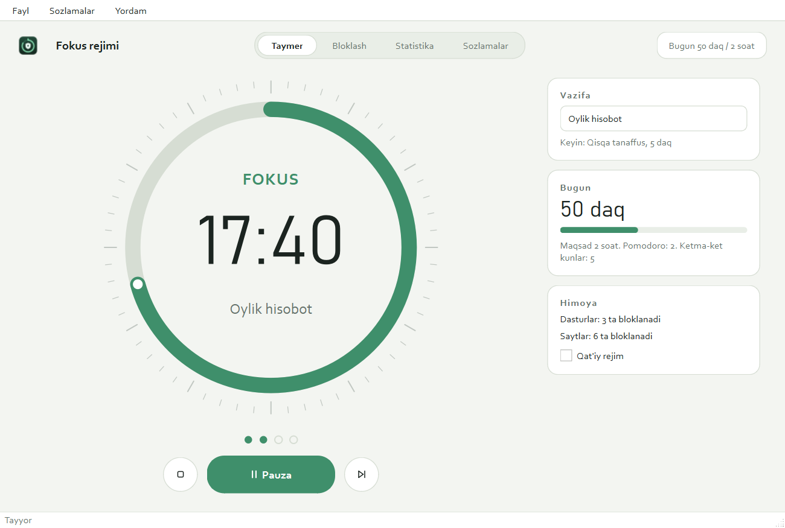
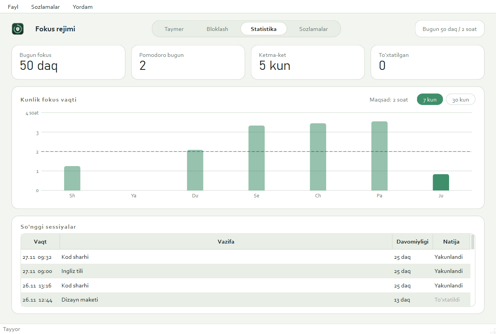

# Fokus rejimi: Uslubiy ko‘rsatma

Muallif: Hakimov Bahtiyorjon. Versiya: 1.0.2.

## 1. Uslubiy ko‘rsatmaning maqsadi va vazifalari

Ushbu uslubiy ko‘rsatmaning maqsadi “Fokus rejimi” dasturidan vaqtni boshqarish, mustaqil ishni tashkil etish, axborot texnologiyalari va operatsion tizimlarga oid fanlarda o‘quv vositasi sifatida foydalanish tartibini belgilashdan iborat. Dastur talabalarga diqqatni jamlab ishlash usulini amalda sinab ko‘rish, o‘z ish ritmini tahlil qilish, shuningdek operatsion tizimdagi jarayonlar va hosts fayli kabi texnik tushunchalarni xavfsiz sharoitda o‘rganish imkonini beradi.

Uslubiy ko‘rsatmaning vazifalari:

- dasturning imkoniyatlari va o‘quv jarayonidagi o‘rnini aniqlash;
- 80 daqiqalik amaliy mashg‘ulotning namunaviy rejasini taklif etish;
- dasturning haqiqiy funksiyalariga asoslangan amaliy topshiriqlar va kutilgan natijalarni berish;
- baholash mezonlari, nazorat savollari va mustaqil ish uchun tavsiyalarni shakllantirish;
- tizim fayllari va jarayonlar bilan ishlashda xavfsizlik qoidalarini eslatish.
Mashg‘ulot natijasida talaba fokus va tanaffus davrlarini rejalashtiradi, taymer holatlari va o‘tishlarini tushuntira oladi, chalg‘ituvchi dasturlar ro‘yxatini tuzadi, dasturlarni bloklashdagi xavfsizlik cheklovlarini biladi, hosts fayli orqali saytlarni bloklash tamoyilini tushuntiradi va statistikani tahlil qiladi.

Ko‘rsatma o‘qituvchiga mashg‘ulotni tayyorlash vaqtini qisqartirish, topshiriqlarni bosqichma-bosqich tashkil etish va talabalar faoliyatini yagona mezonlar asosida baholashda yordam beradi. Topshiriqlar guruhning tayyorgarlik darajasiga va o‘quv kompyuterlaridagi huquqlarga qarab qisqartirilishi yoki kengaytirilishi mumkin.

## 2. Qo‘llash sohasi va maqsadli auditoriya

Dasturdan quyidagi fanlar va mutaxassisliklarda foydalanish tavsiya etiladi:

- “Vaqtni boshqarish”, “O‘qish ko‘nikmalari”, “Shaxsiy samaradorlik” fanlari va treninglari;
- “Operatsion tizimlar” fanida jarayonlar, foydalanuvchi huquqlari va tizim fayllari mavzularida;
- “Kompyuter tarmoqlari” fanida domen nomlari, DNS va hosts fayli mavzularida;
- “Dasturlash texnologiyalari” fanida holatlar mashinasi va testlanadigan arxitektura misoli sifatida;
- tashkilotlarda xodimlarning diqqatni jamlab ishlashi bo‘yicha seminarlar.
Maqsadli auditoriya: oliy ta’lim muassasalari, kollej va texnikumlar o‘qituvchilari va talabalari, shuningdek kompyuterda ishlovchi mutaxassislar. Dasturning asosiy funksiyalaridan foydalanish uchun kompyuterdan boshlang‘ich foydalanish ko‘nikmalari yetarli; saytlarni bloklash bilan bog‘liq topshiriqlar administrator huquqi bor o‘quv kompyuterlarida bajariladi.

Kasbiy faoliyatda dastur dasturchilar, dizaynerlar, tarjimonlar, tahlilchilar kabi uzoq vaqt diqqat talab qiladigan ish bajaruvchi mutaxassislarga ish kunini fokus davrlariga bo‘lish va chalg‘itishlarni kamaytirishda yordam beradi. Dastur foydalanuvchining o‘z ixtiyori bilan ishlatiladigan o‘zini o‘zi cheklash vositasi bo‘lib, boshqalarni nazorat qilish uchun mo‘ljallanmagan.

Mashg‘ulotni operatsion tizim asoslari (jarayon, foydalanuvchi hisobi, tizim fayllari) o‘rganilgandan keyin o‘tkazish maqsadga muvofiq. Vaqtni boshqarish treninglarida esa texnik tayyorgarlik talab etilmaydi: bunday hollarda saytlarni bloklash topshiriqlari o‘tkazib yuborilishi mumkin.

## 3. O‘quv mashg‘ulotida foydalanish tartibi

Quyida “Diqqatni jamlab ishlash: Pomodoro usuli va raqamli chalg‘itishlarni cheklash” mavzusidagi 80 daqiqalik amaliy mashg‘ulot rejasi keltirilgan. Mashg‘ulotdan oldin o‘qituvchi kompyuterlarga dasturni joylashtiradi va fokus davomiyligini mashg‘ulot uchun qisqartirilgan qiymatga (masalan, 10 daqiqa fokus va 2 daqiqa tanaffus) sozlashni rejalashtiradi.

1. Tashkiliy qism (5 daqiqa): davomatni tekshirish, mashg‘ulot maqsadi va kutilgan natijalarni e’lon qilish.
2. Nazariy qism (20 daqiqa): fokus va tanaffus davrlarini almashtirish g‘oyasi; taymer bosqichlari va o‘tishlar (boshlash, pauza, to‘xtatish, o‘tkazib yuborish); dasturlarni bloklash tartibi va xavfsizlik cheklovlari (foydalanuvchi ro‘yxati, joriy foydalanuvchi, tizim jarayonlari); hosts fayli va domen nomlari; zaxira nusxa va blokni olib tashlash; qat’iy rejim. O‘qituvchi dastur oynasini proyektorda namoyish qiladi.
3. Amaliy qism (45 daqiqa): talabalar 1–5-topshiriqlarni bajaradi, jumladan qisqartirilgan davomiylik bilan kamida ikkita to‘liq fokus sessiyasini o‘tkazadi.
4. Yakuniy qism (10 daqiqa): statistika natijalarini muhokama qilish, chalg‘itishlar va ularni cheklash usullari haqida fikr almashish, sozlamalarni standart qiymatlarga qaytarish, uyga vazifa berish.
Nazariy qismda hosts fayli mavzusini tushuntirishda o‘qituvchi faylning matnli tuzilishini ko‘rsatishi, ammo uni qo‘lda tahrirlamasligi tavsiya etiladi: dastur blokni o‘zi yozib, o‘zi olib tashlashi va zaxira nusxa olishi xavfsizlik nuqtai nazaridan muhokama qilinadi.

Amaliy qismda talabalar individual ishlaydi. O‘qituvchi saytlarni bloklash topshirig‘ini oldindan administrator huquqi berilgan bir yoki bir necha kompyuterda tayyorlab qo‘yadi yoki uni namoyish tarzida o‘tkazadi.

Yakuniy qismda muhokama uchun quyidagi savollar taklif etiladi: fokus vaqtida qaysi chalg‘itishlar sezildi; dasturlarni bloklash va qat’iy rejim o‘zini nazorat qilishga qanchalik yordam beradi; tizim fayllarini o‘zgartiruvchi dasturlar qanday xavfsizlik choralariga ega bo‘lishi kerak. Mashg‘ulot oxirida o‘qituvchi barcha kompyuterlarda dasturdan to‘liq chiqilganini tekshiradi.

Mashg‘ulotga tayyorgarlik ko‘rishda o‘qituvchi dasturni oldindan sinab ko‘rishi va sinov uchun ishlatiladigan dasturlar ro‘yxatini tuzib qo‘yishi tavsiya etiladi.

*1-rasm. Mashg‘ulotda namoyish qilinadigan “Taymer” bo‘limi*

*2-rasm. Mashg‘ulot yakunida tahlil qilinadigan “Statistika” bo‘limi*

## 4. Amaliy topshiriqlar

1. **Taymerni sozlash.** “Sozlamalar” bo‘limida fokusni 10 daqiqa, qisqa tanaffusni 2 daqiqa, uzun tanaffusgacha sessiyalarni 2 ga o‘rnating. Kutilgan natija: “Taymer” bo‘limida yangi davomiylik va “Keyin: Qisqa tanaffus, 2 daq” izohi ko‘rinadi.
2. **Fokus sessiyasi.** Vazifa nomini yozib, bitta to‘liq fokus sessiyasini o‘tkazing. Kutilgan natija: signal chalinadi, tanaffus boshlanadi, “Statistika” bo‘limida “Yakunlandi” natijali yozuv paydo bo‘ladi.
3. **Holatlar va o‘tishlar.** Ikkinchi sessiyada pauza, davom ettirish va o‘tkazib yuborish amallarini sinab ko‘ring. Kutilgan natija: pauzada qolgan vaqt saqlanishi va o‘tkazib yuborilgan fokus yakunlangan hisoblanmasligi qayd etiladi.
4. **Dasturlarni bloklash.** “Ishlayotganlardan...” orqali o‘quv kompyuteridagi xavfsiz sinov dasturini (masalan, Bloknot) “Yig‘ish” amali bilan qo‘shing va fokus vaqtida uni oching. Kutilgan natija: ogohlantirish va teskari sanoqdan keyin dastur yig‘iladi.
5. **Tizim jarayonlarini himoyalash.** Ro‘yxatga explorer.exe ni qo‘shishga urinib ko‘ring. Kutilgan natija: “Tizim jarayoni, bloklab bo‘lmaydi” xabari va bu cheklovning zarurligi haqida talabaning izohi.
6. **Saytlarni bloklash (administrator huquqi bor kompyuterda, o‘qituvchi nazoratida).** O‘quv uchun tanlangan bitta domenni qo‘shib, fokus vaqtida uni brauzerda oching, so‘ng tanaffusda qayta oching. Kutilgan natija: fokusda sayt ochilmaydi, tanaffusda ochiladi; talaba buning sababini tushuntiradi.
7. **Qat’iy rejim.** Qat’iy rejimni yoqib, fokus vaqtida to‘xtatishga urinib ko‘ring. Kutilgan natija: ibora so‘raladi va faqat to‘liq yozilganda sessiya to‘xtaydi; talaba katta-kichik harflar va ortiqcha bo‘shliqlar natijaga ta’sir qilmasligini tekshiradi.
8. **Statistika tahlili.** “Statistika” bo‘limida 7 kunlik grafik va so‘nggi sessiyalarni ko‘rib chiqing. Kutilgan natija: bugungi fokus vaqti, pomodorolar soni va to‘xtatilgan sessiyalar soni yozilgan qisqa hisobot.
Topshiriqlar bajarilgach, talaba qisqa hisobot tayyorlaydi: o‘zgartirilgan sozlamalar, o‘tkazilgan sessiyalar va ularning natijasi, bloklash bo‘yicha kuzatuvlar, statistika ko‘rsatkichlari va xulosalar. 1–5-topshiriqlar mashg‘ulot vaqtida, 6–8-topshiriqlar mashg‘ulot oxirida yoki o‘qituvchi ko‘rsatmasi bilan alohida bajariladi. 6-topshiriq faqat administrator huquqi berilgan o‘quv kompyuterlarida bajariladi; bunday imkoniyat bo‘lmasa, o‘qituvchi uni proyektor orqali namoyish qiladi.

Tayyorgarligi yuqori guruhlarda o‘qituvchi qo‘shimcha topshiriq berishi mumkin: fokus vaqtida hosts faylini matn muharririda faqat o‘qish uchun ochib, dastur yozgan belgilar orasidagi blokni ko‘rish va tanaffusda u olib tashlanganini tekshirish.

## 5. Baholash mezonlari

Amaliy ish 100 ball bilan baholanadi:

- taymerni sozlash va fokus sessiyalarini to‘g‘ri o‘tkazish – 20 ball;
- taymer holatlari va o‘tishlarini tushuntirish – 15 ball;
- dasturlarni bloklash ro‘yxatini tuzish va xavfsizlik cheklovlarini izohlash – 20 ball;
- saytlarni bloklash tamoyilini (hosts fayli, zaxira nusxa, blokni olib tashlash) tushuntirish – 15 ball;
- statistika tahlili va hisobot – 15 ball;
- nazorat savollariga javob va muhokamadagi ishtirok – 15 ball.
Baholash shkalasi: 86–100 ball “a’lo”, 71–85 ball “yaxshi”, 55–70 ball “qoniqarli”, 55 balldan kam “qoniqarsiz”. Talabaning fokus vaqti miqdori baholashga ta’sir qilmaydi: dastur bilan ishlash va tushunchalarni izohlash ko‘nikmasi baholanadi.

Topshiriqlar natijalari (hisobot va statistika skrinshotlari) elektron ko‘rinishda, talaba familiyasi yozilgan papkada topshiriladi. Kechikib topshirilgan ishlar uchun ball kamaytirish tartibi o‘qituvchi tomonidan oldindan e’lon qilinadi.

Guruhda ishlaganda har bir talabaning hissasi alohida baholanadi. Xavfsizlik qoidalari buzilgan holatda (masalan, hosts faylini qo‘lda tahrirlash) o‘qituvchi ballni kamaytirishi mumkin.

Yakuniy ball mashg‘ulot oxirida e’lon qilinadi.

## 6. Nazorat savollari

1. Dasturda qaysi bosqichlar mavjud va uzun tanaffus qachon beriladi?
2. Pauza, to‘xtatish va o‘tkazib yuborish amallarining farqi nimada?
3. Bloklangan dastur ochilganda dastur qanday ketma-ketlikda harakat qiladi?
4. Qaysi uchta shart bajarilgandagina dastur jarayonga ta’sir qiladi?
5. Nima uchun tizim jarayonlarini bloklash ro‘yxatiga qo‘shib bo‘lmaydi?
6. hosts fayli qanday vazifani bajaradi va dastur saytlarni u orqali qanday bloklaydi?
7. Saytlarni bloklash nima uchun administrator huquqini talab qiladi?
8. Dastur kutilmaganda yopilsa, hosts faylidagi blok bilan nima sodir bo‘ladi?
9. Qat’iy rejim qanday ishlaydi va u nimaga xizmat qiladi?
10. Statistikada “Ketma-ket” ko‘rsatkichi qanday hisoblanadi?
Nazorat savollari og‘zaki so‘rov, yozma test yoki mustaqil ish himoyasida qo‘llanilishi mumkin. 3, 4, 6 va 8-savollarga javob berishda talaba amaliy topshiriqlarda kuzatgan holatlardan misol keltirishi tavsiya etiladi.

Javoblarni baholashda talabaning dastur interfeysidagi nomlarni to‘g‘ri atashi va xavfsizlik cheklovlarining sababini o‘z so‘zlari bilan izchil tushuntira olishi hisobga olinadi.

## 7. Mustaqil ish uchun tavsiyalar

- Bir hafta davomida mustaqil o‘qish va uy vazifalarini “Fokus rejimi” yordamida bajaring va “Statistika” bo‘limi asosida qaysi kunlar va soatlarda diqqatni jamlash osonroq bo‘lganini tahlil qiling.
- Turli fokus davomiyliklarini (masalan, 25 va 45 daqiqa) sinab ko‘rib, o‘zingiz uchun qulay rejimni asoslang.
- Taymer holatlar mashinasining diagrammasini chizing: holatlar, o‘tishlar va ularni chaqiruvchi amallarni ko‘rsating.
- hosts fayli va DNS ishlash tamoyili haqida qisqa referat tayyorlang, saytlarni bloklashning boshqa usullari bilan solishtiring.
- O‘zingiz uchun chalg‘ituvchi dasturlar va saytlar ro‘yxatini tuzing va ularning har biri uchun “Yopish” yoki “Yig‘ish” amalini tanlashni asoslang.
- Fokus vaqtida yuzaga kelgan chalg‘itishlar (xabar, qo‘ng‘iroq, ijtimoiy tarmoq) sonini bir necha kun qog‘ozda qayd eting va ularni dastur sozlamalari yordamida qanday kamaytirish mumkinligini tahlil qiling.
Mustaqil ish natijalari keyingi mashg‘ulotda qisqa taqdimot shaklida himoya qilinadi.

Himoya jarayonida talaba o‘z tahlilining asosiy xulosalarini va diqqatni jamlash bo‘yicha shaxsiy rejasini qisqa bayon qiladi.

## 8. Xavfsizlik va axborot madaniyati qoidalari

Dastur operatsion tizim jarayonlari va tizim fayli bilan ishlagani uchun mashg‘ulotda talabalarga quyidagi qoidalarni tushuntirish va ularga rioya etilishini nazorat qilish tavsiya etiladi:

- Dasturlarni bloklashni sinashdan oldin barcha ochiq hujjatlarni saqlang; sinov uchun muhim ma’lumot saqlanmagan dasturlardan foydalaning.
- Saytlarni bloklash topshiriqlari faqat o‘qituvchi ruxsati bilan va administrator huquqi berilgan o‘quv kompyuterlarida bajariladi; hosts faylini qo‘lda tahrirlamang.
- Mashg‘ulot oxirida taymerni to‘xtating, dasturdan to‘liq chiqing va sozlamalarni standart qiymatlarga qaytaring; bu hosts faylidagi blok olib tashlanishini ta’minlaydi.
- Boshqa foydalanuvchining kompyuterida bloklash funksiyalarini uning roziligisiz ishlatmang.
- Dasturni faqat muallifning rasmiy GitHub sahifasidan yuklab oling.
- Tanaffuslarda ekrandan uzoqlashing, ko‘z va qad-qomat gigiyenasiga rioya qiling.
